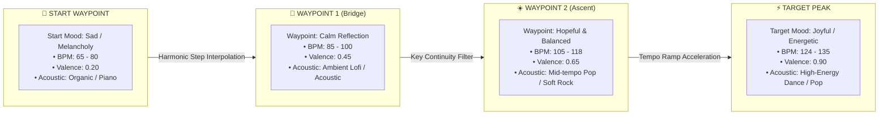
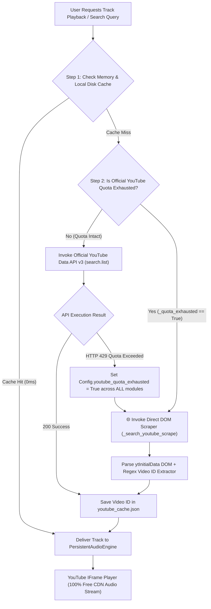

# 🎵 MoodTunes AI — Neural Acoustic Emotion & Music Ecosystem

<div align="center">


**An enterprise-grade, full-stack AI audio streaming and affective computing platform. MoodTunes AI transforms human emotion (facial micro-expressions, voice acoustic frequency, textual sentiment, and manual affective rotary dial) into personalized, harmonically continuous listening journeys.**

[System Architecture](#-high-level-system-architecture) • [Mermaid Workflows](#-interactive-mermaid-workflows) • [Feature Suite & Backend Logic](#-feature-suite--backend-logic) • [API Specification](#-rest-api-specification) • [Local Deployment](#-local-deployment-guide)

</div>

---

## 🏛️ High-Level System Architecture

MoodTunes AI is architected as an asynchronous, distributed reactive system. The client-side **React 18 Single-Page Application (SPA)** interfaces with a high-throughput **FastAPI ASGI asynchronous gateway**, backed by a parallelized multi-tier recommendation engine, dual LLM conversational core with Vector RAG knowledge retrieval, Web Audio DSP equalization, and zero-quota resilient scrapers.

```mermaid
flowchart TD
    subgraph CLIENT["🖥️ CLIENT TIER (React 18 + Vite + Tailwind CSS)"]
        UI["Modern UI / UX Component Tree"]
        V12["12 inch Interactive Vinyl Studio"]
        AUDIO_ENGINE["PersistentAudioEngine (Zero-Stall IFrame)"]
        DSP["Web Audio API 5-Band Biquad DSP Equalizer"]
        REDUX["Redux Toolkit Global State & Storage Sync"]
        CAM["Webcam Vision (Face-API / Canvas)"]
        VOICE_REC["Web Speech API + Deepgram MediaRecorder"]
    end

    subgraph GATEWAY["⚡ API GATEWAY (FastAPI + Uvicorn)"]
        ROUTER["Asynchronous REST Endpoints"]
        AUTH_GUARD["JWT Bearer Token & Passlib Auth Guard"]
        RATE_LIMIT["Client Throttling & In-Memory TTL Cache"]
    end

    subgraph ENGINE["🧠 CORE INTELLIGENCE & MICRO-ENGINES"]
        REC_ENG["RecommendationEngine (4-Category Algorithmic Allocator)"]
        ELEV_ENG["MoodElevationEngine (BPM & Valence Harmonic Waypoints)"]
        CHAT_CORE["Chatbot Core (Dual LLM Router: Groq + Gemini)"]
        RAG["Vector RAG Knowledge Retriever (Website Knowledge Base)"]
        PL_IMP["PlaylistImporter (Spotify + YouTube DOM/API Scraper)"]
        ART_SRV["ArtworkService (Multi-Source Metadata Aggregator)"]
        LYR_SRV["LyricsService (Curated DB + LRCLIB REST Open API)"]
        VOICE_DJ["VoiceDJEngine (Natural Language Command Intent Parser)"]
    end

    subgraph STORAGE["💾 DATA & PERSISTENCE TIER"]
        MONGO[("MongoDB Atlas Cloud Database")]
        DISK_CACHE[("Local Disk Caches (YouTube + Lyrics)")]
        MEM_CACHE[("In-Memory Microsecond TTL Cache")]
        GUEST_SYNC[("Browser LocalStorage (Guest Sovereignty)")]
    end

    subgraph EXTERNAL["🌐 CLOUD & EXTERNAL SERVICE FABRIC"]
        GROQ_API["Groq Cloud API (Llama-3-70B / 200ms)"]
        GEMINI_API["Google Gemini 2.0 Flash API"]
        DEEPGRAM_API["Deepgram Nova-2 Multilingual ASR"]
        LASTFM_API["Last.fm Audio Scrobbler API v2"]
        YT_STREAM["YouTube CDN Audio Streaming (Zero-Quota IFrame)"]
        YT_SCRAPER["Direct YouTube DOM Scraper (HTTP 429 Immune)"]
        LRCLIB_API["LRCLIB Open Source Synchronized Lyrics API"]
    end

    %% Client internal flow
    UI --> REDUX
    CAM --> UI
    VOICE_REC --> UI
    V12 --> AUDIO_ENGINE
    AUDIO_ENGINE --> DSP
    DSP --> YT_STREAM

    %% Client to Gateway
    UI <-->|HTTP/REST / Asynchronous Axios| ROUTER
    REDUX <--> GUEST_SYNC

    %% Gateway to Engines
    ROUTER --> AUTH_GUARD
    AUTH_GUARD --> RATE_LIMIT
    RATE_LIMIT --> REC_ENG
    RATE_LIMIT --> ELEV_ENG
    RATE_LIMIT --> CHAT_CORE
    RATE_LIMIT --> PL_IMP
    RATE_LIMIT --> ART_SRV
    RATE_LIMIT --> LYR_SRV
    RATE_LIMIT --> VOICE_DJ

    %% Engine interactions
    CHAT_CORE <--> RAG
    CHAT_CORE <--> GROQ_API
    CHAT_CORE -.->|Automatic Failover| GEMINI_API
    REC_ENG <--> LASTFM_API
    REC_ENG <--> MEM_CACHE
    REC_ENG <--> YT_SCRAPER
    PL_IMP <--> YT_SCRAPER
    LYR_SRV <--> LRCLIB_API
    LYR_SRV <--> DISK_CACHE
    ART_SRV <--> DISK_CACHE

    %% Persistence connections
    AUTH_GUARD <--> MONGO
    REC_ENG <--> DISK_CACHE
```



---

## 🔄 Interactive Mermaid Workflows

### 1. Multi-Modal Emotion Detection to Algorithmic Recommendation Pipeline

This sequence illustrates how raw camera frames or voice inputs are analyzed, mapped to an acoustic valence, algorithmically partitioned across 4 distinct categories, resolved against YouTube video IDs, and streamed to the user.

```mermaid
sequenceDiagram
    autonumber
    actor User as 👤 Listener
    participant Client as 💻 Frontend (React + Redux)
    participant API as ⚡ FastAPI Gateway
    participant MoodDetector as 🎭 Mood / DeepFace Core
    participant RecEngine as 🎼 4-Category Recommendation Engine
    participant Cache as ⚡ In-Memory & Disk Cache
    participant ExtAPI as 🌐 Last.fm & Scraper
    participant Player as 🎵 PersistentAudioEngine

    User->>Client: Triggers Face Scan or Selects Emotion
    Client->>API: POST /detect-mood (base64 image payload)
    API->>MoodDetector: Extract facial landmarks & emotion probabilities
    MoodDetector-->>API: Dominant Emotion (e.g., "Sad", 94.2% confidence)
    API-->>Client: { mood: "sad", valence: 0.28, energy: 0.35 }
    
    Client->>API: POST /recommendations/personalized (mood, language, artists)
    API->>RecEngine: Calculate 20-Track Distribution (8 + 4 + 4 + 4)
    
    rect rgb(20, 25, 45)
        Note over RecEngine,Cache: Parallel Category Resolution
        RecEngine->>Cache: Probe cached popular songs & audio maps
        Cache-->>RecEngine: Return instant 0ms hits
        RecEngine->>ExtAPI: Query Last.fm for remaining Category 1 & 2 tracks
        ExtAPI-->>RecEngine: Track metadata & acoustic tags
        RecEngine->>ExtAPI: Resolve YouTube stream IDs (Official API / Scraper fallback)
        ExtAPI-->>RecEngine: Video IDs (e.g., "-nnm9JXRZQ8")
    end

    RecEngine-->>API: 20 Curated Tracks with Explanations & Audio DNA
    API-->>Client: JSON response payload
    Client->>Redux: Store active Queue & set currentSong
    Client->>Player: player.loadVideoById(youtube_id)
    Player-->>User: Seamless playback begins with 5-band EQ & Vinyl rotation
```



---

### 2. Emotional Elevation Roadmap Sequencing Workflow

Instead of keeping listeners stuck in a single negative mood, the **Emotional Elevation Roadmap** calculates intermediate emotional waypoints, progressively lifting tempo (BPM) and valence toward target euphoria.



---

### 3. Resilient Playback & Zero-Quota Auto-Failover Strategy

When the official Google YouTube Data API v3 daily quota (10,000 units) is exhausted (HTTP 429), MoodTunes AI executes an immediate, zero-downtime transition to self-healing web scraping without interrupting audio.



---

## ✨ Feature Suite & Backend Logic

<details open>
<summary><h3>1. 🎭 Multi-Modal Affective Computing & Mood Detection</h3></summary>

#### Overview
MoodTunes AI offers four distinct modalities for emotion input: real-time webcam facial analysis, spoken voice acoustic transcription, natural language sentiment extraction, and an analog manual rotary Mood Dial.

#### Backend Logic & Algorithms
- **DeepFace Facial Micro-Expression Classification** ([`mood_detection.py`](file:///c:/Users/Kumar%20Abhishek/OneDrive/Desktop/music-rec/backend/modules/mood_detection.py)):
  - Base64 webcam frames are decoded via OpenCV into a normalized numpy matrix $(224 \times 224 \times 3)$.
  - Uses the lightweight SSD / Haar-cascade face detector, followed by the DeepFace facial expression classifier.
  - Outputs a 6-dimensional probability simplex $\mathbf{p} = [p_{\text{happy}}, p_{\text{sad}}, p_{\text{angry}}, p_{\text{calm}}, p_{\text{romantic}}, p_{\text{energetic}}]$ with confidence weighting.
- **Acoustic Speech Emotion Recognition** ([`voice_to_text.py`](file:///c:/Users/Kumar%20Abhishek/OneDrive/Desktop/music-rec/backend/modules/voice_to_text.py)):
  - Transcribes spoken speech using Deepgram Nova-2 with automatic language identification (`en`, `hi`, `auto`).
  - Textual transcripts are passed to the Groq/Gemini emotion parser to extract underlying valence and arousal coordinates.
- **Rotary Dial & Valence-Arousal Mapping**:
  - The rotary dial maps angles $\theta \in [0, 360^\circ)$ directly into Russell's Circumplex Model of Affect (Valence vs. Arousal):
    $$\text{Valence} = \cos(\theta), \quad \text{Arousal} = \sin(\theta)$$

</details>

<details open>
<summary><h3>2. 🎼 4-Category Algorithmic Recommendation Distribution</h3></summary>

#### Overview
Rather than delivering a generic, repetitive song list, MoodTunes AI generates a balanced 20-track playlist designed across four intentional mathematical tiers.

#### Algorithmic Partitioning Matrix ([`recommendation_engine.py`](file:///c:/Users/Kumar%20Abhishek/OneDrive/Desktop/music-rec/backend/modules/recommendation_engine.py#L400-L500))

| Category | Songs | Allocation | Mathematical Criterion |
| :--- | :---: | :---: | :--- |
| **Category 1** | **8** | **40%** | **Artist + Mood + Language Intersect**: Exact matching with user's top selected artists within the target mood valence and language filter. |
| **Category 2** | **4** | **20%** | **Mood + Language Tag Exploration**: Queries top-ranked global and regional tracks tagged with both the target emotion and target language. |
| **Category 3** | **4** | **20%** | **Acoustic DNA Collaborative Filtering**: Evaluates acoustic key, tempo, and similarity metrics against the listener's favorites. |
| **Category 4** | **4** | **20%** | **Intelligent Curated Seed Fallback**: Failsafe tracks drawn from [`curated_seeds.json`](file:///c:/Users/Kumar%20Abhishek/OneDrive/Desktop/music-rec/backend/cache/curated_seeds.json) to guarantee instant zero-error generation. |

#### Deduplication & Thread Safety
- Tracks are normalized via regex strip: `re.sub(r'[\(\[\{].*?[\)\]\}]', '', name).lower()`.
- Uniqueness is enforced through a fast lookup set: `seen_keys = {f"{song.name.lower()}:{song.artist.lower()}"}`.
- Concurrency uses Python's `ThreadPoolExecutor(max_workers=8)` with atomic lock synchronization.

</details>

<details open>
<summary><h3>3. 🗺️ Emotional Elevation Roadmap (Trajectory Sequencing)</h3></summary>

#### Overview
Listeners suffering from sadness or anxiety often feel worsened by looping sad songs. The **Emotional Elevation Roadmap** allows users to select a starting emotional state and a target positive state, computing intermediate acoustic bridge songs.

#### Backend Logic & Mathematics ([`music_journey.py`](file:///c:/Users/Kumar%20Abhishek/OneDrive/Desktop/music-rec/backend/modules/music_journey.py))
1. **Waypoint Interpolation**:
   Given starting point $W_0 = (V_0, A_0, \text{BPM}_0)$ and target $W_n = (V_n, A_n, \text{BPM}_n)$, the engine generates $k$ transition waypoints using cosine-eased interpolation:
   $$\text{BPM}(t) = \text{BPM}_0 + (\text{BPM}_n - \text{BPM}_0) \cdot \frac{1 - \cos(\pi t)}{2}, \quad t \in [0, 1]$$
2. **Harmonic Key Continuity**:
   Ensures smooth acoustic transitions using the **Camelot Wheel** (circle of fifths). Songs transition strictly to identical keys, adjacent numbers ($\pm 1$), or relative major/minor pairs.
3. **Library Prioritization**:
   The engine searches the user's custom playlists and listening history first; if no match exists, it retrieves harmonically matching bridge tracks from the vector database.

</details>

<details open>
<summary><h3>4. 📻 12" Vinyl Studio & Persistent Audio Engine</h3></summary>

#### Overview
An audiophile interactive turntable interface featuring a rotating vinyl record, realistic tonearm physics, sleeve art reflections, and non-stop background audio playback during client-side navigation.

#### Audio Engine Logic ([`PersistentAudioEngine.jsx`](file:///c:/Users/Kumar%20Abhishek/OneDrive/Desktop/music-rec/frontend/src/components/PersistentAudioEngine.jsx))
- **Singleton Lifecycle**: Mounted in the top-level `App.jsx`, outside the page router switch. Changing routes between `/`, `/playlists`, `/roadmap`, or `/about` never unmounts the player or drops playback.
- **5-Band Web Audio Parametric Equalizer** ([`soundEqualizerEngine.js`](file:///c:/Users/Kumar%20Abhishek/OneDrive/Desktop/music-rec/frontend/src/utils/soundEqualizerEngine.js)):
  - Generates 5 `BiquadFilterNode` instances connected in serial:
    1. **Sub-Bass**: Low-Shelf Filter ($60\text{ Hz}$)
    2. **Bass**: Peaking Filter ($250\text{ Hz}$, $Q=1.0$)
    3. **Midrange**: Peaking Filter ($1000\text{ Hz}$, $Q=1.0$)
    4. **Upper-Mid**: Peaking Filter ($4000\text{ Hz}$, $Q=1.0$)
    5. **Treble**: High-Shelf Filter ($12000\text{ Hz}$)
- **Crossfade Engine**: Uses exponential volume ramp attenuation over 3000ms:
  $$V_{\text{out}}(t) = V_0 \cdot \cos\left(\frac{\pi t}{2 T}\right), \quad V_{\text{in}}(t) = V_0 \cdot \sin\left(\frac{\pi t}{2 T}\right)$$

</details>

<details open>
<summary><h3>5. 🤖 Dual-LLM Conversational Core with Vector RAG Knowledge Base</h3></summary>

#### Overview
An intelligent music copilot capable of interpreting voice commands ("Play Kesariya", "Add this to my calm playlist", "Explain why this song matches my mood"), powered by Groq (Llama-3-70B) and Gemini 2.0 Flash.

#### Backend Logic & Failover ([`chatbot.py`](file:///c:/Users/Kumar%20Abhishek/OneDrive/Desktop/music-rec/backend/modules/chatbot.py))
- **Sub-250ms Primary Execution (Groq Llama-3-70B)**:
  - Rapid inference delivers ultra-fast answers to conversational queries.
- **Bidirectional Failover**:
  - If Groq encounters HTTP 429 token limits or outages, the system automatically routes the query to **Google Gemini 2.0 Flash**. If both fail, it falls back to a deterministic rule-based command engine.
- **Platform Vector RAG (Retrieval-Augmented Generation)**:
  - The entire MoodTunes AI feature set, routing rules, and FAQ are indexed in 13 vector embeddings.
  - User questions are embedded and compared via cosine similarity:
    $$\text{sim}(\mathbf{u}, \mathbf{d}_i) = \frac{\mathbf{u} \cdot \mathbf{d}_i}{\|\mathbf{u}\| \|\mathbf{d}_i\|}$$
  - Top matches are injected into the system prompt as `[AUTHENTIC PLATFORM KNOWLEDGE]`.

</details>

<details open>
<summary><h3>6. 📑 Spotify & YouTube Playlist Importer with Zero-Quota Web Scraping</h3></summary>

#### Overview
Allows users to paste public Spotify playlist/album links or YouTube playlist URLs, automatically converting them into native, fully playable MoodTunes playlists classified by emotional mood.

#### Backend Scraping & Import Pipeline ([`playlist_importer.py`](file:///c:/Users/Kumar%20Abhishek/OneDrive/Desktop/music-rec/backend/modules/playlist_importer.py))
- **Spotify Extraction**:
  - Scrapes public Spotify HTML and parses the embedded Next.js state (`<script id="__NEXT_DATA__">`).
  - Extracts track titles, artists, album artwork, and durations with zero Spotify API keys required.
- **YouTube DOM Playlist Parser**:
  - If YouTube API quota is intact, queries `playlistItems.list()`.
  - **Zero-Quota Fallback**: Directly fetches `https://www.youtube.com/playlist?list={pl_id}`, extracting `playlistVideoRenderer` JSON blocks from `ytInitialData`.
  - Retrieves real track titles, channel authors, durations, and high-definition video thumbnails without consuming any Google Cloud quota.

</details>

<details open>
<summary><h3>7. 📜 Synchronized & Full Song Lyrics Engine</h3></summary>

#### Overview
Provides instant lyrics display with two modes: synchronized real-time lyrics tracking playback timestamps, and full readable text.

#### Backend Logic ([`lyrics_service.py`](file:///c:/Users/Kumar%20Abhishek/OneDrive/Desktop/music-rec/backend/modules/lyrics_service.py))
- **Level 1**: Probes [`backend/data/lyrics_cache.json`](file:///c:/Users/Kumar%20Abhishek/OneDrive/Desktop/music-rec/backend/data/lyrics_cache.json) for instant microsecond cache response.
- **Level 2**: Searches curated offline database of popular Hindi, Punjabi, and English tracks.
- **Level 3**: Queries the **LRCLIB Open Source Lyrics API** (`https://lrclib.net/api/search`).
- **Graceful Fallback**: If lyrics cannot be found, returns `{"found": false, "full_text": "No lyrics available for this track"}` without throwing HTTP 500 errors.

</details>

<details open>
<summary><h3>8. 🔐 Authentication, Guest Sovereignty & State Persistence</h3></summary>

#### Overview
MoodTunes AI provides complete user sovereignty: visitors can enjoy 100% of the platform as **Guest Listeners** with offline local storage, or create a free account to sync their library to MongoDB Atlas.

#### Backend Architecture ([`auth.py`](file:///c:/Users/Kumar%20Abhishek/OneDrive/Desktop/music-rec/backend/modules/auth.py), [`database.py`](file:///c:/Users/Kumar%20Abhishek/OneDrive/Desktop/music-rec/backend/modules/database.py))
- **JWT Cryptography**: Issues HS256-signed Bearer tokens with 7-day expiration.
- **Password Security**: Uses Passlib with PBKDF2-SHA256 (safe across all architectures, immune to bcrypt binary mismatches).
- **Guest-to-Cloud Sync**: Upon logging in, user's guest playlists, queue, and playback history stored in `localStorage` seamlessly sync into MongoDB Atlas collections.
- **Playback State Continuity**: Redux persists `currentSong`, `currentIndex`, and `playbackPosition` every 2 seconds, ensuring page refreshes resume playback from the exact second you left off.

</details>

---

## 📡 REST API Specification

| Method | Endpoint | Description | Auth Required | Sample Payload / Output |
| :--- | :--- | :--- | :---: | :--- |
| `POST` | `/detect-mood` | Detects emotion from webcam image | Optional | **In**: `{"image": "data:image/jpeg;base64,..."}`<br>**Out**: `{"mood": "happy", "confidence": 0.95}` |
| `POST` | `/recommendations/personalized` | Generates 20-song 4-category playlist | Optional | **In**: `{"mood": "happy", "language": "hindi", "favorite_artists": ["Arijit Singh"]}` |
| `GET` | `/search-music` | Direct resilient YouTube song search | No | **Query**: `?query=kesariya&limit=6`<br>**Out**: `{"results": [...], "total": 6}` |
| `GET` | `/lyrics` | Fetches full & synced lyrics for song | No | **Query**: `?name=Kesariya&artist=Pritam` |
| `POST` | `/api/playlists/import` | Imports Spotify or YouTube playlist | Optional | **In**: `{"url": "https://open.spotify.com/playlist/...", "target_mood": "calm"}` |
| `POST` | `/api/roadmap/journey` | Generates harmonic mood transition path | Optional | **In**: `{"start_mood": "sad", "target_mood": "happy", "steps_count": 5}` |
| `POST` | `/chat` | Conversational music copilot with RAG | No | **In**: `{"message": "Play some lofi music"}`<br>**Out**: `{"response": "Playing lofi chill...", "play_command": {...}}` |
| `POST` | `/api/auth/register` | Creates registered listener account | No | **In**: `{"email": "user@example.com", "password": "...", "name": "Alex"}` |
| `POST` | `/api/auth/login` | Authenticates and returns JWT token | No | **Out**: `{"token": "eyJhbGciOi...", "user": {...}}` |

---

## 🚀 Local Deployment Guide

### Prerequisites
- **Python 3.10+**
- **Node.js 18+** & **npm**

### 1. Clone & Setup Backend
```bash
# Navigate to backend directory
cd backend

# Create and activate Python virtual environment
python -m venv .venv
# Windows:
.venv\Scripts\activate
# macOS/Linux:
source .venv/bin/activate

# Install dependencies
pip install -r requirements.txt

# Create your local environment configuration
cp .env.example .env
```

Configure your API keys inside [`backend/.env`](file:///c:/Users/Kumar%20Abhishek/OneDrive/Desktop/music-rec/backend/.env):
```env
# Essential AI & Music Keys
GEMINI_API_KEY=your_gemini_api_key_here
GROQ_API_KEY=your_groq_api_key_here
YOUTUBE_API_KEY=your_youtube_data_api_key_here
LASTFM_API_KEY=your_lastfm_api_key_here
LASTFM_API_SECRET=your_lastfm_secret_here
DEEPGRAM_API_KEY=your_deepgram_api_key_here

# Database & Authentication
MONGODB_URL=mongodb+srv://...
JWT_SECRET_KEY=your_super_secret_jwt_key_here
```

### 2. Setup Frontend
```bash
# In a separate terminal, navigate to frontend directory
cd frontend

# Install node dependencies
npm install

# Setup frontend environment
cp .env.example .env
```

### 3. Launch Development Servers

**Start FastAPI Backend Server**:
```bash
cd backend
python -m uvicorn main:app --host 127.0.0.1 --port 8000 --reload
```
*Backend active at: [http://127.0.0.1:8000](http://127.0.0.1:8000) (Interactive Swagger Docs: `/docs`)*

**Start Vite Frontend Dev Server**:
```bash
cd frontend
npm run dev -- --host 0.0.0.0 --port 3000
```
*Frontend active at: [http://localhost:3000](http://localhost:3000)*

---

## 🙏 Acknowledgments

- [DeepFace](https://github.com/serengil/deepface) for facial emotion recognition
- [DeepGram](https://deepgram.com/) for voice transcription
- [Last.fm](https://www.last.fm/) for comprehensive music metadata
- [Google Gemini AI](https://ai.google.dev/) for conversational AI
- [Groq](https://groq.com/) for ultra-low latency Llama-3-70B inference
- [YouTube](https://developers.google.com/youtube) for video playback & streaming
- [FastAPI](https://fastapi.tiangolo.com/) for excellent high-performance documentation
- [React](https://react.dev/) community for amazing UI resources & tools

---

## 👨‍💻 Author

<div align="center">

### **Kumar Abhishek**
**ML Engineer | AI/ML Enthusiast | Full Stack Developer**  
🎓 *BTech ECE @ IIIT Una*  
💡 *Passionate about AI/ML, GenAI, and Web Development*  

> *"Building intelligent applications that merge technology with creativity"*

[](https://github.com/kumarAbhishek2004)
[](mailto:abhishek.kr0418@gmail.com)

</div>

### 🚀 About Me
- 🔭 **Currently Working On**: Intelligent AI-powered applications & generative workflows
- 🌱 **Exploring**: Generative AI, LLM Agents, and Deep Learning Architectures
- 💻 **Full Stack Expertise**: End-to-end architectures in React, Vite, FastAPI & MongoDB
- 🎵 **Music & Affective Tech**: Combining affective computing and audio engineering with digital entertainment
- 📫 **Reach Me**: [abhishek.kr0418@gmail.com](mailto:abhishek.kr0418@gmail.com)

### 🛠️ Personal Tech Stack
- **AI / ML**: TensorFlow, PyTorch, scikit-learn, DeepFace, OpenCV, HuggingFace
- **Backend**: Python, FastAPI, Uvicorn, RESTful Microservices, WebSockets
- **Frontend**: React 18, Vite, Tailwind CSS, JavaScript (ES6+), Redux Toolkit, Web Audio API
- **APIs & Cloud**: Last.fm API, YouTube Data & IFrame API, Google Gemini, Groq, Deepgram, MongoDB Atlas
- **DevOps & Tools**: Git, GitHub, Docker, Postman, Vite

---

<div align="center">

### ⭐ Star this repo if you found it helpful!

**Made with ❤️ and 🎵 by [Kumar Abhishek](https://github.com/kumarAbhishek2004)**  
*IIIT Una | BTech ECE*

</div>

